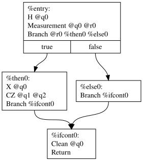
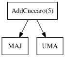
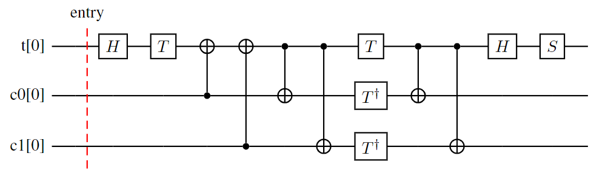

\page main Main

`quration-core/main/` implements the qret binaries.

## How to use

Use the `--help` option to check how to use the binary.
Run a command after the binary, such as `./qret compile ...` or `./qret simulate ...`, followed by the options for that command.
Currently, the following nine commands are implemented.

1. `asm` : outputs assembly from a target JSON file (pipeline state)
2. `compile` : compiles an input file for a target quantum computer
3. `diagram` : visualizes the intermediate representation
4. `export` : exports the intermediate representation to files in other formats
5. `opt` : optimizes the intermediate representation
6. `parse` : parses files in various formats and creates the intermediate representation
7. `print` : prints the instruction sequence of the intermediate representation in a human-readable form
8. `profile` : outputs statistics from a target JSON file (pipeline state)
9. `simulate` : runs the intermediate representation with a simulator

```sh
$ qret --help
-- Quration: Quantum Resource Estimation Toolchain for FTQC (version 0.7.2) --

Usage:
  qret [command] [options]

Example usage:
  qret help [ -h, --help ]
  qret version [ -v, --version ]
  qret compile -h
  qret simulate -h
Available commands:
  help version asm compile diagram export opt parse print profile simulate
```

## Command: asm

The `asm` command outputs assembly from a target pipeline state file.
Use the `--help` option to check how to use the `asm` command.

```sh
$ qret asm --help
qret 'asm' options:
  -h [ --help ]                         Show this help and exit.
  --quiet                               Suppress non-error output.
  --verbose                             Enable verbose logging (more detail
                                        than default).
  --debug                               Enable debug logging (most detailed;
                                        implies --verbose).
  --color                               Enable colored output.
  -s [ --source ] arg (=SC_LS_FIXED_V0) Source representation. Currently only
                                        'SC_LS_FIXED_V0' is supported.
  -t [ --target ] arg (=SC_LS_FIXED_V0) Target name used to select asm printer.
  --print-metadata BOOL (=1)            Print instruction metadata. If false,
                                        SC_LS_FIXED_V0 output will omit
                                        instruction metadata.
  -i [ --input ] arg                    Input file
  -o [ --output ] arg (=out.asm)        Output file
```

## Command: compile

The `compile` command compiles an input file into the instruction sequence of the target quantum computer.
Use the `--help` option to check how to use the `compile` command.

```sh
$ qret compile --help

qret 'compile' options:
  -h [ --help ]                         Show this help and exit.
  --help-hidden                         Show help including hidden options.
  --quiet                               Suppress non-error output.
  --verbose                             Enable verbose logging (more detail than default).
  --debug                               Enable debug logging (most detailed; implies --verbose).
  --color                               Enable colored output.
  --pipeline FILE                       Path to a pipeline specification file.
  -i [ --input ] FILE                   Path to the input file.
  -f [ --function ] NAME                [source=IR] Name of the function to compile.
  -o [ --output ] FILE (=a.json)        Path to the output SC_LS_FIXED_V0 file.
  -s [ --source ] KIND (=IR)            Source representation: 'IR', 'OpenQASM2', or 'SC_LS_FIXED_V0'.
  -t [ --target ] KIND (=SC_LS_FIXED_V0)
                                        Target machine name.
  --sc_ls_fixed_v0_topology FILE        Path to the SC_LS_FIXED_V0 topology file.
  --sc_ls_fixed_v0_topology_type TYPE (=auto)
                                        SC_LS_FIXED_V0 machine type: 'Dim2', 'Dim3', 'DistributedDim2', or 
                                        'DistributedDim3' (currently unsupported). When 'auto' (default), the type is 
                                        inferred from --sc_ls_fixed_v0_topology as the minimum required.
  --sc_ls_fixed_v0_enable_pbc_mode      Enable Pauli Based Computing lowering mode.
  --sc_ls_fixed_v0_use_magic_state_cultivation 
                                        Simulate magic-state factories using the cultivation method (requires 
                                        --sc_ls_fixed_v0_magic_factory_seed_offset,
                                        --sc_ls_fixed_v0_magic_generation_success_probability).
  --sc_ls_fixed_v0_magic_factory_seed_offset arg (=0)
                                        Base seed offset for RNG initialization of each magic-state factory. Required 
                                        only if --sc_ls_fixed_v0_use_magic_state_cultivation=true.
  --sc_ls_fixed_v0_magic_generation_period arg (=15)
                                        Beats required to produce one magic state.
  --sc_ls_fixed_v0_magic_generation_success_probability arg (=1)
                                        Per-attempt success probability for magic-state creation. Required only if 
                                        --sc_ls_fixed_v0_use_magic_state_cultivation=true.
  --sc_ls_fixed_v0_magic_generation_maximum_stock arg (=10000)
                                        Maximum number of magic states storable in a factory.
  --sc_ls_fixed_v0_entanglement_generation_period arg (=100)
                                        Beats required to generate one entangled pair.
  --sc_ls_fixed_v0_entanglement_generation_maximum_stock arg (=10)
                                        Maximum number of entangled pairs storable in a factory.
  --sc_ls_fixed_v0_reaction_time arg (=1)
                                        Feed-forward latency in beats from measurement to error-corrected value.
  --sc_ls_fixed_v0_logical_error_rate_base arg (=0)
                                        Physical error rate p for logical error estimation.
  --sc_ls_fixed_v0_logical_error_rate_drop_rate arg (=0)
                                        Drop rate Lambda for logical error estimation.
  --sc_ls_fixed_v0_code_cycle_time_sec arg (=0)
                                        Code cycle time in seconds (t_cycle) for execution time estimation.
  --sc_ls_fixed_v0_allowed_failure_probability arg (=0)
                                        Allowed failure probability (eps) for logical error estimation.
  --sc_ls_fixed_v0_magic_factory_cell_count arg (=1)
                                        Number of surface code cells per magic state factory for resource estimation.
                                        Qubit plane always uses 1 cell per factory regardless of this value.
  --sc_ls_fixed_v0_pass PASS            SC_LS_FIXED_V0 compile pass to run. Accepts a single pass or a comma-separated list.
  --sc_ls_fixed_v0_dump_compile_info_to_json arg  Dump compile information to json
  --sc_ls_fixed_v0_dump_compile_info_to_markdown arg
                                        Dump compile information to markdown
```

Explanation of non-trivial options:

* `--function` : name of the function to compile
  * Required when `--source IR` is used.
  * Optional as the entry circuit name when `--source OpenQASM2` is used.
* `--source` : specifies the type of the input file
  * Specifies what kind of instruction sequence the input file contains.
  * `IR`: the input file is an intermediate representation defined in a JSON file.
  * `OpenQASM2`: the input file is OpenQASM2.
  * `SC_LS_FIXED_V0`: the input file is an SC_LS_FIXED_V0 pipeline state file.
* `--target` : specifies the compilation target machine
  * Currently, specify `SC_LS_FIXED_V0`.
* `sc_ls_fixed_v0_topology` : path to the file that specifies the topology
* `sc_ls_fixed_v0_topology_type` : specifies which SC_LS_FIXED_V0 language to compile to
  * `Dim2`, `Dim3`, `DistributedDim2`, `DistributedDim3` (currently unsupported)
  * If omitted, one of `Dim2`, `Dim3`, `DistributedDim2`, or `DistributedDim3` is selected automatically from the topology file.
* `sc_ls_fixed_v0_enable_pbc_mode` : enables Pauli Based Computing (PBC) lowering
* `sc_ls_fixed_v0_use_magic_state_cultivation` : simulates implementing magic-state factories with the cultivation method
* `sc_ls_fixed_v0_magic_factory_seed_offset` : seed offset for magic-state factories; the actual seed is this offset plus the magic-state factory ID
  * Effective only when `--sc_ls_fixed_v0_use_magic_state_cultivation=true`.
* `sc_ls_fixed_v0_magic_generation_period` : number of beats required for a magic-state factory to create one magic state
* `sc_ls_fixed_v0_magic_generation_success_probability` : probability that a magic-state factory successfully creates one magic state
  * Effective only when `--sc_ls_fixed_v0_use_magic_state_cultivation=true`.
* `sc_ls_fixed_v0_magic_generation_maximum_stock` : number of magic states that a magic-state factory can store
* `sc_ls_fixed_v0_entanglement_generation_period` : number of beats required for a logical-entanglement factory to create one entangled pair
* `sc_ls_fixed_v0_entanglement_generation_maximum_stock` : number of entangled pairs that a logical-entanglement factory can store
* `sc_ls_fixed_v0_reaction_time` : number of beats required until error correction of a measured register
* `sc_ls_fixed_v0_logical_error_rate_base` : physical error rate `p` for QEC resource estimation
* `sc_ls_fixed_v0_logical_error_rate_drop_rate` : drop rate `Lambda` for QEC resource estimation
* `sc_ls_fixed_v0_code_cycle_time_sec` : code cycle time `t_cycle` in seconds for QEC resource estimation
* `sc_ls_fixed_v0_allowed_failure_probability` : allowed failure probability `eps` for QEC resource estimation
* `sc_ls_fixed_v0_pass` : specifies optimization passes to run on SC_LS_FIXED_V0 machine code
  * Separate multiple optimization passes with `,`.
  * Example: specify the following to obtain compile-time information for the instruction sequence:
* `sc_ls_fixed_v0_magic_factory_cell_count` : The number of surface code cells for magic-state factory, used for resource estimation
  * deafult to `1`. Raise error when `0`.
  * Effective cell count is calculated as `effective_cell_count = chip_cell_count + magic_factory_count * (magic_factory_cell_count - 1)`
  * Qubit plane always uses a single cell for each magic-factory
* `"sc_ls_fixed_v0::calc_info_without_topology,sc_ls_fixed_v0::calc_info_with_topology"`
* `sc_ls_fixed_v0_dump_compile_info_to_json` : dumps compile-time statistics in JSON format
* `sc_ls_fixed_v0_dump_compile_info_to_markdown` : dumps compile-time statistics in Markdown format

### Specifying Optimization Pass Parameters

qret sets optimization pass parameters with global variables.
Some global variables can be specified from the command line.
Use `--help-hidden` to check the list of configurable global variables.

```sh
$ qret compile --help-hidden
(omitted)

Hidden options:
  --help-really-hidden                  Display available options including really hidden ones
  --ir-static-condition-pruning-seed arg (=0)
                                        Seed of StaticConditionPruningPass
  --sc_ls_fixed_v0-find-place-algorithm arg (=0)
                                        Find place algorithm of mapping (0: EnoughSpaceSoft, 1: EnoughSpaceHard)
  --sc_ls_fixed_v0-inst-queue-peek-size arg (=1000)
                                        Peek size of instruction queue
  --sc_ls_fixed_v0-inst-queue-weight-algorithm arg (=2)
                                        Weight algorithm of instruction queue (0: index, 1: type, 2: InvDepth)
  --sc_ls_fixed_v0-mapping-algorithm arg (=1)
                                        Mapping algorithm (0: Map based on topology file, 1: Auto)
  --sc_ls_fixed_v0-partition-algorithm arg (=0)
                                        Partition algorithm of mapping (0: Greedy, 1: Random, 2: METIS)
  --sc_ls_fixed_v0-partition-seed arg (=314)
                                        Random seed of mapping partition when partition algorithm is Random.
  --sc_ls_fixed_v0-print-inst-metadata arg (=0)
                                        Print metadata of instructions (beat and z coordinate).
  --sc_ls_fixed_v0-route-searcher-type arg (=0)
                                        Route searcher strategy (0: default)
  --sc_ls_fixed_v0-state-buffer-width arg (=20)   Buffer width of quantum states
  --sc_ls_fixed_v0_dump_pbc_string arg  Dump pauli string if PBC mode is enabled
  --sc_ls_fixed_v0_runtime_simulation_pruning_seed arg (=0)
                                        Seed
```

* `ir-static-condition-pruning-seed` : offset used to compute values for random instructions in the intermediate representation
  * Used by `StaticConditionPruningPass`.
  * Values of random instructions in the intermediate representation are determined in advance, and branch destinations are determined in advance as much as possible.
* `sc_ls_fixed_v0-find-place-algorithm` : algorithm for finding where to place qubits during mapping
* `sc_ls_fixed_v0-inst-queue-peek-size` : length of the instruction sequence read by the
  instruction queue during routing and topology-free runtime estimation
  * A larger value lets the scheduler read further ahead and may produce better routing or estimates.
  * However, routing and topology-free runtime estimation take longer.
* `sc_ls_fixed_v0-inst-queue-weight-algorithm` : weighting algorithm for the instruction queue
  during routing and topology-free runtime estimation
  * When multiple instructions are executable, their weights determine the scheduling order.
* `sc_ls_fixed_v0-mapping-algorithm` : mapping algorithm
  * `0` maps according to the topology file.
  * `1` maps while ignoring qubit coordinate information in the topology file.
    * Magic-state factories and entanglement factories are not ignored.
* `sc_ls_fixed_v0-partition-algorithm` : algorithm for selecting which chip each qubit is assigned to when compiling to multinode SC_LS_FIXED_V0
  * `METIS` is not implemented.
* `sc_ls_fixed_v0-partition-seed` : random seed used when `sc_ls_fixed_v0-partition-algorithm` is `Random`
* `sc_ls_fixed_v0-print-inst-metadata`
  * Outputs metadata as well as instructions in assembly.
  * Metadata:
    * when the instruction was executed during routing
    * at which z coordinate the instruction was executed during routing
* `sc_ls_fixed_v0-route-searcher-type` : routing searcher strategy
* `sc_ls_fixed_v0-state-buffer-width` : number of beats held by the state buffer during routing
  * The state buffer holds all states of the quantum computer from beat `t` through beat `s`.
  * The width is `t - s + 1`.
  * A larger width holds more states and enables a wider search.
  * However, routing takes longer.
* `sc_ls_fixed_v0_dump_pbc_string` : path to dump Pauli strings when PBC mode is enabled
* `sc_ls_fixed_v0_runtime_simulation_pruning_seed` : seed used by `RuntimeSimulationPruning`

### Example 1: Compile an Intermediate Representation to SC_LS_FIXED_V0

To compile the intermediate representation `quration-core/examples/data/circuit/add_cuccaro_5.json` to SC_LS_FIXED_V0, run the following command.

```sh
qret compile --verbose --input quration-core/examples/data/circuit/add_cuccaro_5.json --function "AddCuccaro(5)" --output quration-core/examples/data/add_cuccaro_5.json --sc_ls_fixed_v0_topology quration-core/examples/data/topology/tutorial.yaml
```

### Example 2: Output an SC_LS_FIXED_V0 Pipeline State File and Optimize It with an External Library

Output an SC_LS_FIXED_V0 pipeline state file.

```sh
qret compile --verbose --input quration-core/examples/data/circuit/add_cuccaro_5.json --function "AddCuccaro(5)" --output pipeline_state.json --sc_ls_fixed_v0_topology quration-core/examples/data/topology/tutorial.yaml --sc_ls_fixed_v0_pass "sc_ls_fixed_v0::mapping,sc_ls_fixed_v0::routing"
```

Assume that `pipeline_state.json` has been optimized somehow.
After that, run the following command with `qret` to output the optimized SC_LS_FIXED_V0 pipeline state file again.

```sh
qret compile --verbose --input pipeline_state.json --output out2.json --source SC_LS_FIXED_V0 --target SC_LS_FIXED_V0 --sc_ls_fixed_v0_topology quration-core/examples/data/topology/tutorial.yaml --sc_ls_fixed_v0_pass "sc_ls_fixed_v0::calc_info_without_topology,sc_ls_fixed_v0::calc_info_with_topology,sc_ls_fixed_v0::dump_compile_info"
```

### Example 3: Compile with a Pipeline File

You can compile by defining compile inputs, outputs, pass order, and other settings in a pipeline file and passing that file to qret.
When specifying pass order and related settings in a pipeline file, paths to external libraries can also be included.
`quration-core/examples/data/pipeline/qret_compile.yaml` adds a pass named `My3DRouting`.

```sh
qret compile --verbose --pipeline quration-core/examples/data/pipeline/qret_compile.yaml
```

## Command: diagram

The `diagram` command visualizes the intermediate representation defined in a JSON file in various formats.
Use the `--help` option to check how to use the `diagram` command.

```sh
$ qret diagram --help
qret 'diagram' options:
  -h [ --help ]         Show this help and exit.
  --quiet               Suppress non-error output.
  --verbose             Enable verbose logging (more detail than default).
  --debug               Enable debug logging (most detailed; implies 
                        --verbose).
  --color               Enable colored output.
  -i [ --input ] arg    Input file
  --function arg         The name of function to draw
  -o [ --output ] arg   Output file (default is 'out.dot' or 'out.tex')
  -g [ --graph-format ] arg   Format of diagram to generate ('CFG', 'CallGraph', 
                        'LaTeX', or 'ComputeGraph')
  --display_num_calls   [CallGraph] Display how many times function is called
```

### Example 1: CFG

Selecting `CFG` with `--graph-format` visualizes the circuit's Control Flow Graph (CFG) in the DOT language.
The following command outputs `out.dot`.

```sh
qret diagram --verbose -i quration-core/examples/data/circuit/add_craig_5.json --function "UncomputeTemporalAnd" --graph-format CFG
```



### Example 2: CallGraph

Selecting `CallGraph` with `--graph-format` visualizes the circuit's Call Graph in the DOT language.
The following command outputs `out.dot`.

```sh
qret diagram --verbose -i quration-core/examples/data/circuit/add_cuccaro_5.json --function "AddCuccaro(5)" --graph-format CallGraph
```



### Example 3: Circuit Diagram

Selecting `LaTeX` with `--graph-format` visualizes a circuit diagram using the LaTeX quantikz package.
The following command outputs `out.tex`.

```sh
qret diagram -i quration-core/examples/data/circuit/add_craig_5.json --function "TemporalAnd" --graph-format LaTeX
```



## Command: export

The `export` command exports the intermediate representation defined in a JSON file to a file in another format.
Currently, only QIR (`.ll`) is supported.
Use the `--help` option to check how to use the `export` command.

```sh
$ qret export --help
qret 'export' options:
  -h [ --help ]                 Show this help and exit.
  --quiet                       Suppress non-error output.
  --verbose                     Enable verbose logging (more detail than 
                                default).
  --debug                       Enable debug logging (most detailed; implies 
                                --verbose).
  --color                       Enable colored output.
  -i [ --input ] arg            Input IR json file
  -o [ --output ] arg (=out.ll) Output file
  -f [ --format ] arg (=qir)    Format of output file ('qir').
  --entry arg                   Name of the entry function within the input IR 
                                module. If empty, uses the input JSON's own 
                                'entry_function' field, falling back to the 
                                module's first function if that's absent too.
  --inline                      Inline all sub-circuit calls into the entry 
                                function and drop the now-unused functions, 
                                producing single-entry-point QIR (more 
                                compatible with QIR consumers; may enlarge the 
                                output for circuits that reuse sub-circuits 
                                heavily).
```

## Command: opt

The `opt` command optimizes the intermediate representation.
Use the `--help` option to check how to use the `opt` command.

```sh
$ qret opt --help
qret 'opt' options:
  -h [ --help ]                         Show this help and exit.
  --quiet                               Suppress non-error output.
  --verbose                             Enable verbose logging (more detail 
                                        than default).
  --debug                               Enable debug logging (most detailed; 
                                        implies --verbose).
  --color                               Enable colored output.
  --pipeline arg                        Pipeline file
  -i [ --input ] arg                    Input file
  -f [ --function ] arg                  The name of function to compile
  -o [ --output ] arg                   Output file
  --ir-static-condition-pruning-seed arg (=0)
                                        Seed of ir::static_condition_pruning 
                                        pass.
  --pass arg                            Optimization pass
```

## Command: parse

The `parse` command creates the intermediate representation from files in various formats.
Use the `--help` option to check how to use the `parse` command.

```sh
$ qret parse --help
qret 'parse' options:
  -h [ --help ]                    Show this help and exit.
  --quiet                          Suppress non-error output.
  --verbose                        Enable verbose logging (more detail than 
                                   default).
  --debug                          Enable debug logging (most detailed; implies
                                   --verbose).
  --color                          Enable colored output.
  -i [ --input ] arg               Input file
  -o [ --output ] arg (=ir.json)   Output file
  -f [ --format ] arg (=OpenQASM2) Format of input file ('OpenQASM2', 
                                   'OpenQASM3', or 'qir'). OpenQASM3 is a 
                                   compatibility subset.

QIR import (--format qir) limitations:
  Subroutines whose parameters are qubits/results are imported as sub-circuits.
  A subroutine that takes a classical scalar parameter (e.g. a rotation angle) is
  rejected: Quration-IR circuits cannot carry scalar arguments. Inline such
  subroutines before importing (for example, with LLVM: `opt -passes=inline`,
  then `globaldce`).
```

## Command: print

The `print` command prints the instruction sequence of the intermediate representation defined in a JSON file in a human-readable form.
Use the `--help` option to check how to use the `print` command.

```sh
$ qret print --help
qret 'print' options:
  -h [ --help ]           Show this help and exit.
  --quiet                 Suppress non-error output.
  --verbose               Enable verbose logging (more detail than default).
  --debug                 Enable debug logging (most detailed; implies 
                          --verbose).
  --color                 Enable colored output.
  -i [ --input ] arg      Path to input IR file.
  -s [ --summary ]        Print summary only. If --function is omitted, prints module summary.
  -f [ --function ] arg    Function name; with --summary, prints only that function's summary.
  -d [ --depth ] arg (=1) Descend only 'depth' call deep
  --print_debug_info      Print debug info
```

## Command: profile

The `profile` command calculates and outputs statistics from a target pipeline state file.
Use the `--help` option to check how to use the `profile` command.

```sh
$ qret profile --help
qret 'profile' options:
  -h [ --help ]                         Show this help and exit.
  --quiet                               Suppress non-error output.
  --verbose                             Enable verbose logging (more detail
                                        than default).
  --debug                               Enable debug logging (most detailed;
                                        implies --verbose).
  --color                               Enable colored output.
  -s [ --source ] arg (=SC_LS_FIXED_V0) Source representation. Currently only
                                        'SC_LS_FIXED_V0' is supported.
  -f [ --format ] arg (=json)           Output format: 'json' or 'markdown'.
  -i [ --input ] arg                    Input file
  -o [ --output ] arg (=compile_info.json)
                                        Output file
```

## Command: simulate

The `simulate` command simulates a function in the intermediate representation defined in a JSON file.

```sh
$ qret simulate --help
qret 'simulate' options
Simulate a function in an IR file.

Examples:
  qret simulate --input <ir-file> --function <name>
  qret simulate --input <ir-file> --function <name> --state Toffoli --max_superpositions 16 --init_state 0101 --num_samples 8
  qret simulate --input <ir-file> --function <name> --state FullQuantum --print_raw
:
  -h [ --help ]                    Show this help and exit.
  --quiet                          Suppress non-error output.
  --verbose                        Enable verbose logging (more detail than default).
  --debug                          Enable debug logging (most detailed; 
                                    implies --verbose).
  --color                          Enable colored output.
  -i [ --input ] arg                Path of input IR file.
  -f [ --function ] arg             Function name to simulate.
  -s [ --state ] arg (=FullQuantum) Simulation model. Allowed values:
                                    FullQuantum, Toffoli. Aliases:
                                    full|fullquantum for FullQuantum, tof for
                                    Toffoli.
  --init_state arg                  Initial state as binary string for all
                                    circuit qubits. The first char is q0,
                                    second is q1, ... (LSB-first). E.g.
                                    --init_state 0101 means q0=0, q1=1, q2=0,
                                    q3=1. Whitespace and '_' are ignored; 0b
                                    prefix is accepted. Empty means all zeros.
  --seed arg (=1)                   Seed for the first run. For repeated runs,
                                    this value is incremented by 1 each time.
  -n [ --num_samples ] arg (=0)     Number of simulation runs. Seeds are
                                    changed for each run using `seed +
                                    run_index`. If omitted and --print_raw is
                                    not set for FullQuantum, defaults to 10.
  --sample_summary                  Output only sampling summary (FullQuantum
                                    only).
  --print_raw                       For FullQuantum: print expanded state
                                    vector. For Toffoli, raw state is shown.
  --use_qulacs                      [FullQuantum] Use Qulacs backend if
                                    available.
  --max_superpositions arg (=1)     [Toffoli] Maximum number of superpositions
                                    allowed during simulation.
```

### Example 1: Simulate a Cuccaro Adder Circuit

This example simulates the calculation `6+=19` with the width-5 Cuccaro adder circuit `quration-core/examples/data/circuit/add_cuccaro_5.json`.
The name of the function to run is `AddCuccaro(5)`, so add `--function "AddCuccaro(5)"`.
In `AddCuccaro(5)`, the first 5 qubits are the addition destination, and the next 5 qubits are the addition source.
Because the destination is `6`, initialize the first 5 qubits to `01100` (the first character in the string is q0).
Because the source is `19`, initialize the next 5 qubits to `11001`.
Together, add `--init_state 0110011001`.

```sh
$ qret simulate --input quration-core/examples/data/circuit/add_cuccaro_5.json --function "AddCuccaro(5)" --state Toffoli --init_state 0110011001
[Run Configuration]
  function            AddCuccaro(5)
  qubit_count         11
  model               Toffoli
  initial_state       01100110010
  seed                1
  num_samples         0
  print_raw           false
  max_superpositions  1
[Argument Initialization]
  | name | size | bit_range | bits  | value |
  |------|------|-----------|-------|-------|
  | dst  |    5 | q[0..4]   | 01100 |     6 |
  | src  |    5 | q[5..9]   | 11001 |    19 |
  | aux  |    1 | q10       | 0     |     0 |
  note: bit order is q0 q1 ... in printed strings.
[Toffoli State]
  num_superpositions  1
[Final State]
  basis               10011110010
  probability         1.000000
[Argument Final State]
  | name | size | bit_range | bits  | value |
  |------|------|-----------|-------|-------|
  | dst  |    5 | q[0..4]   | 10011 |    25 |
  | src  |    5 | q[5..9]   | 11001 |    19 |
  | aux  |    1 | q10       | 0     |     0 |
  note: bit order is q0 q1 ... in printed strings.
[Raw State]
  global_phase: (+1.000000+0.000000i)
  | idx  | basis(q0..qN-1) | coef                   | prob         |
  |------|-----------------|------------------------|--------------|
  |    1 | 10011110010     | (+1.000000+0.000000i)  | 1.000000     |
```

`final state` prints the qubit values. The result can be interpreted as follows.

* `10011110010` = `10011` + `11001` + `0`
  * `10011` : destination
    * Since `25=6+19`, the expected destination is `10011`, confirming the correct result.
  * `11001` : source
    * The source value is expected to remain unchanged, confirming the correct result.
  * `0` : aux
    * The Cuccaro adder circuit uses one auxiliary qubit.
    * The auxiliary qubit is expected to be `0` at the end.

### Example 2: Simulate a Craig Adder Circuit

`quration-core/examples/data/circuit/add_craig_5.json` is the intermediate representation of a width-5 Craig adder circuit.
This circuit calculates `19+=6`.
The Craig adder circuit passes through a superposition state during simulation.
Therefore, add the option `--max_superpositions=2` to increase the maximum number of superposition states allowed by `ToffoliState` to 2.

```sh
$ qret simulate --input quration-core/examples/data/circuit/add_craig_5.json --function "AddCraig(5)" --state Toffoli --init_state 1100101100 --max_superpositions 2
[Run Configuration]
  function            AddCraig(5)
  qubit_count         14
  model               Toffoli
  initial_state       1100101100
  seed                1
  num_samples         0
  print_raw           false
  max_superpositions  2
[Argument Initialization]
  | name | size | bit_range | bits  | value |
  |------|------|-----------|-------|-------|
  | dst  |    5 | q[0..4]   | 11001 |    25 |
  | src  |    5 | q[5..9]   | 01100 |    12 |
  | aux  |    4 | q[10..13] | 0000  |     0 |
  note: bit order is q0 q1 ... in printed strings.
[Toffoli State]
  num_superpositions  1
[Final State]
  basis               10011011000000
  probability         1.000000
[Argument Final State]
  | name | size | bit_range | bits  | value |
  |------|------|-----------|-------|-------|
  | dst  |    5 | q[0..4]   | 10011 |    25 |
  | src  |    5 | q[5..9]   | 01100 |    12 |
  | aux  |    4 | q[10..13] | 0000  |     0 |
  note: bit order is q0 q1 ... in printed strings.
[Raw State]
  global_phase: (+1.000000+0.000000i)
  | idx  | basis(q0..qN-1) | coef                   | prob         |
  |------|-----------------|------------------------|--------------|
  |    1 | 10011011000000     | (+1.000000+0.000000i)  | 1.000000     |
```

* `10011011000000` = `10011` + `01100` + `0000`
  * `10011` : destination
    * Since `25=19+6`, the expected destination is `10011`, confirming the correct result.
  * `01100` : source
    * The source value is expected to remain unchanged, confirming the correct result.
  * `0000` : aux
    * The width-4 Craig adder circuit uses four auxiliary qubits.
    * The auxiliary qubits are expected to be `0000` at the end.
